# Monochrome Unicorn

*A web app for Zebra thermal printers.*

[](LICENSE)

[](#installing)

A single-page console that runs **on** a Zebra printer: the build folds
everything into one `INDEX.SHTML` and uploads it to the printer's flash,
where its onboard web server serves it at `http://<printer>/`. Nothing
to install on the computers, phones or tablets that use it -- open the
printer's address in a browser.

**Install:** [download and double-click](#download-and-double-click) ·
[one line in a terminal](#from-a-terminal) ·
[from the source](#from-the-source)

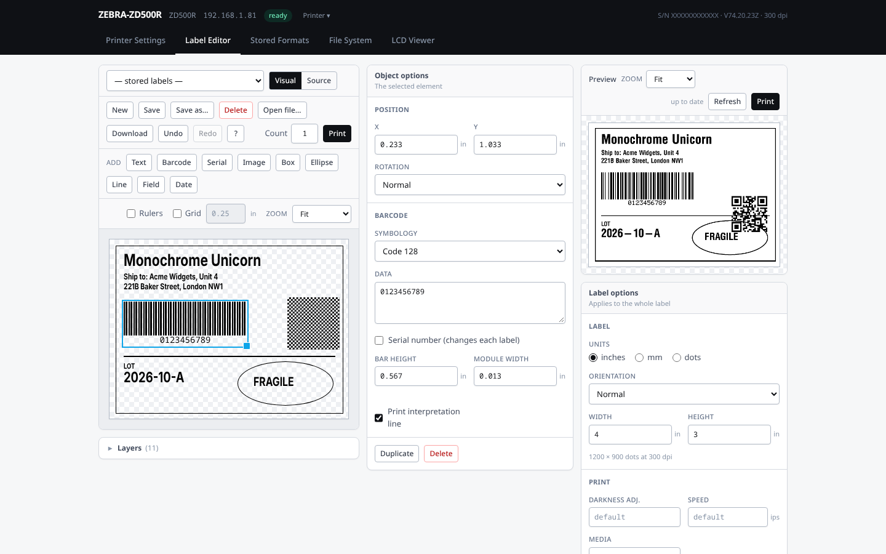

**Contents:** [Screenshots](#screenshots) ·
[Installing](#installing) · [Deploying](#deploying) ·
[Why it is built this way](#why-it-is-built-this-way) ·
[Working on it](#working-on-it) · [Known limits](#known-limits) ·
[Licence](#licence)

## Screenshots

**Printer Settings** -- every setting (aka SGD) on the printer, filtered, explained and edited in place.

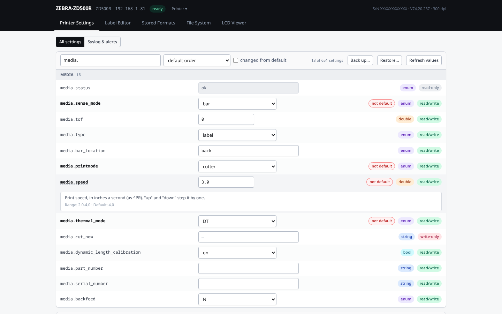

Only the settings changed from their factory default.

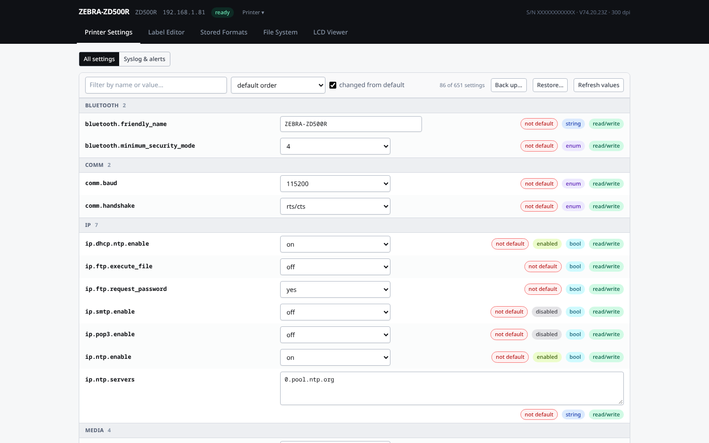

The odometers, and the media sensor's readings against its thresholds.

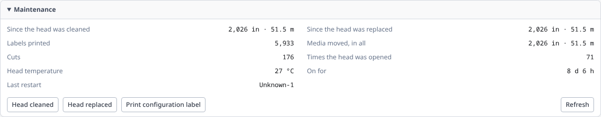

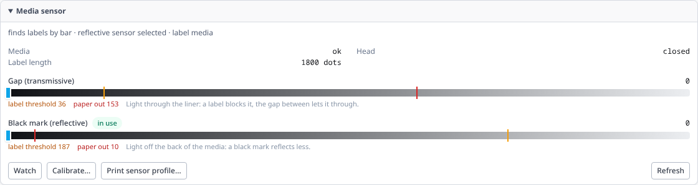

The printer's syslog, a line at a time, with its destinations and alerts below.

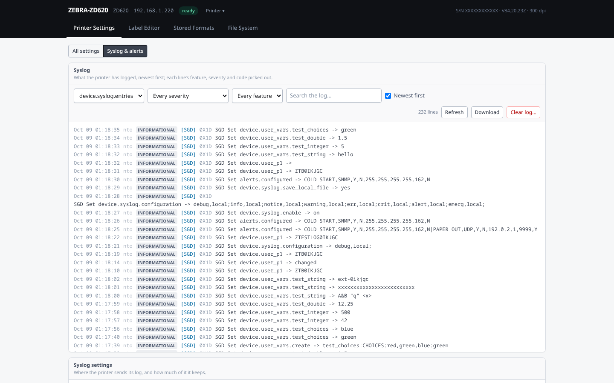

The Printer menu: what is otherwise done at the printer.

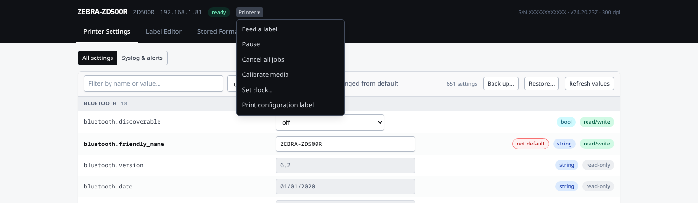

**Label Editor** -- drag text, barcodes, images and shapes around the
canvas; the selected element's options in the middle, the printer's
render on the right.


The preview is not a simulation: the label's ZPL goes to the printer's
own `/zpl` endpoint, and the picture that comes back is drawn by the
same ZPL engine, fonts and firmware that will print it. Online
previewers such as [Labelary](https://labelary.com) emulate that engine
instead, so they can differ from the printer in how text and barcodes
rasterize and in firmware-specific behaviour, and they cannot draw the
fonts and graphics stored on your printer. Here what you see is what
the printer will print.

The source view, with the command under the cursor explained.

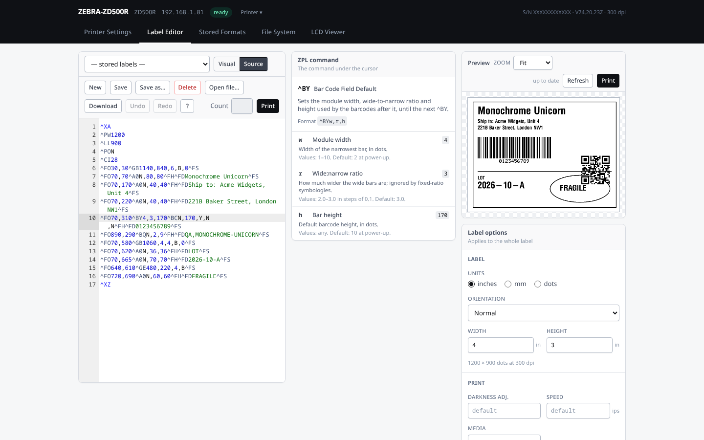

**Stored Formats** -- fill in a stored format's fields, previewed by the printer.

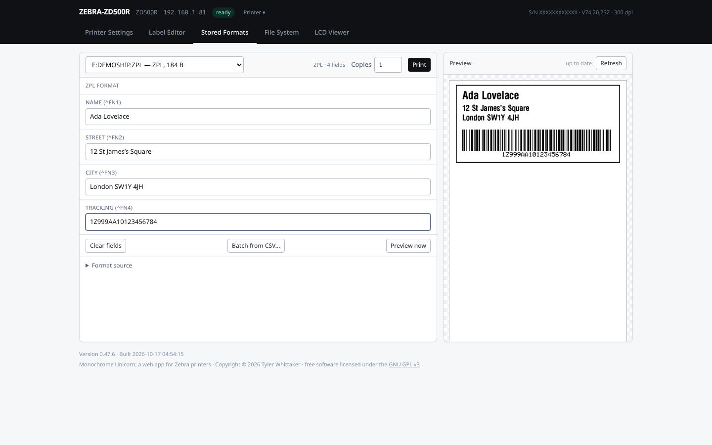

**File System** -- every file on every drive, and what can be done to it.

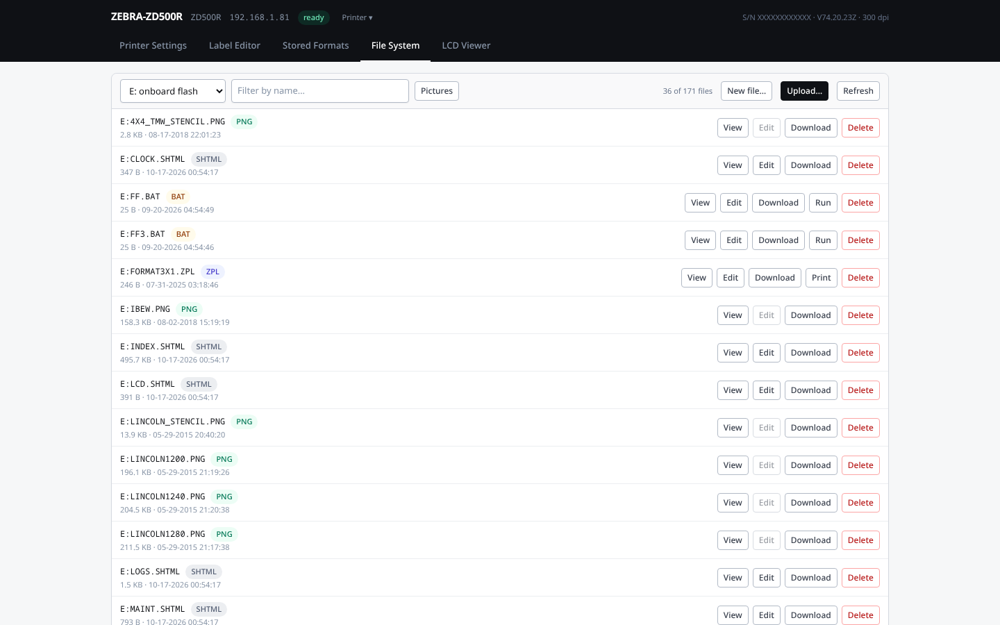

Every stored graphic as a thumbnail.

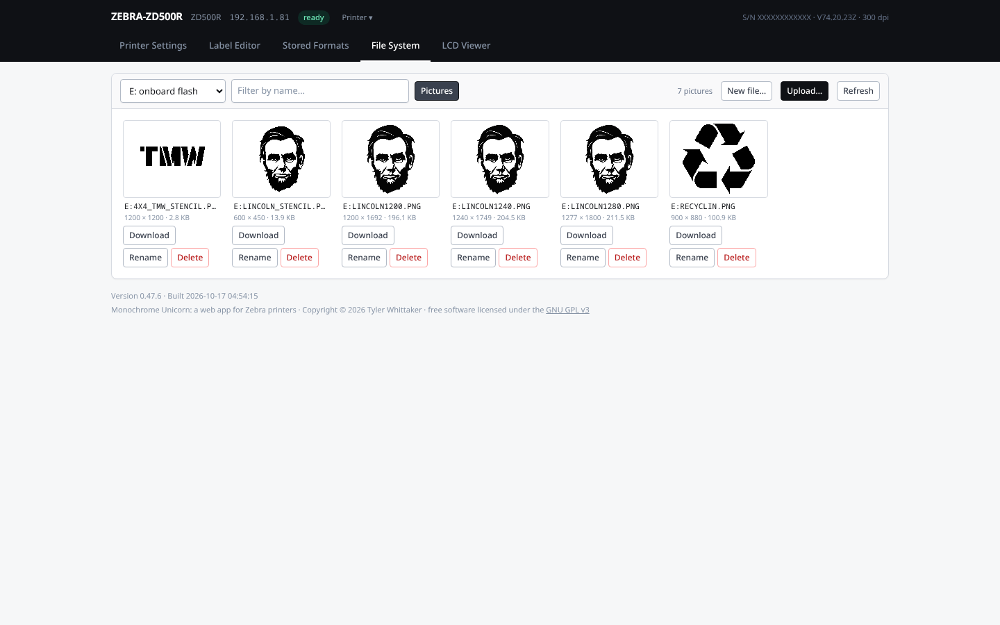

**LCD Viewer** -- the front panel, mirrored, with buttons that press the
printer's own. On its own, the page can only read the screen as text
(`display.text`), so it redraws the screen from that text and the menu
file on screen: laid out as the panel lays it out, with the menu's
pictures, and the printer's own menus in the panel's own font. For
Zebra's menus that is the panel pixel for pixel; a menu in another font
gets the right layout in a stand-in font:

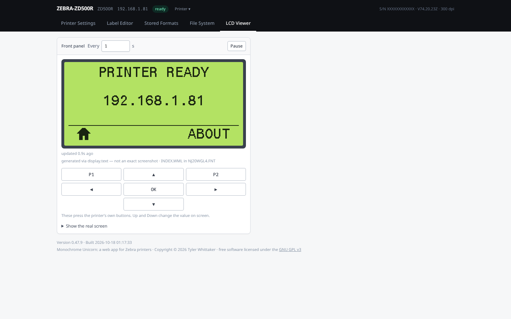

The real screen is a bitmap (`display.image`), but the printer's web
server cuts every value off at its first NUL byte, four bytes into the
picture, and the port that returns it whole (9100) is not one a browser
can open. For the real thing, whatever is on screen, run
`lcd_display_helper.sh` on any computer that can reach the printer: it
reads the bitmap over port 9100 each second and stores it in the
printer's RAM, where the page picks it up and draws the printer's own
pixels:

```sh
./lcd_display_helper.sh <printer-ip>      # Ctrl-C to stop
```

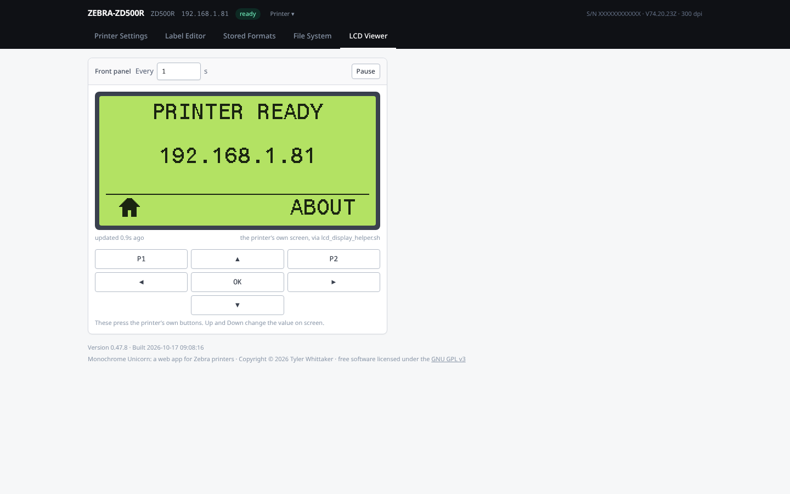

## Installing

You install it once, from any computer on the same network as the
printer; after that, anything with a browser uses it at
`http://<printer>/`.

**The printer:** a Zebra Link-OS printer with its web server on (the
factory setting), whose address you know -- most show it on the front
panel, and it is on the printer's configuration label. Built and tested against a ZD500R (firmware V74.20.23Z) and a
ZD620 (V84.20.23Z); older printers (firmware below V68) work with fewer
details -- see [Known limits](#known-limits).

**The computer you install from** needs to reach the printer on port 80
and port 9100. Nothing else: the installer is one file that carries
what it needs.

### Download and double-click

On the [latest release](https://github.com/TylerWhittaker/monochrome-unicorn/releases/latest), under **Assets**,
download the file for your computer. Each is named for the version it
installs, so for 0.50.1 the Windows one is
`monochrome-unicorn-0.50.1-windows-x64.exe`:

| Your computer | The file ending in |
|---|---|
| Windows 10 or 11 | `-windows-x64.exe` |
| Mac with Apple silicon (M1 and later) | `-macos-arm64.zip` |
| Mac with an Intel processor | `-macos-x64.zip` |
| Linux, 64-bit PC | `-linux-x64` |
| Linux, 64-bit ARM (a Raspberry Pi on 64-bit Raspberry Pi OS) | `-linux-arm64` |

Open it. It opens a page in your browser that lists the Zebra printers
it found on your network. Tick the ones to install on -- or type a
printer's address, or a range of addresses to scan for printers, and
press **Add** -- then press **Install**, and when it says so, **Open the
console**. Several printers are installed on one after another, each
with its own result. The installer stops when you press Quit or close
its window. Run it again after a printer's firmware is updated -- each
install reads that printer's own catalogue of settings.

It finds printers with Zebra's discovery broadcast (UDP port 4201),
which every Zebra print server answers but which does not cross a
router, and which a printer can have turned off. For a printer on
another network, give its range instead -- `192.168.2.0/24` or
`192.168.2.0/255.255.255.0`, or a range in any of the four numbers,
`192.168.2.10-50` or `192.168.1-2.1-254` -- and each address in it is
asked directly, and one that does not answer has its home page checked
for "Zebra". Nothing is sent to the port that prints until an address
is known to be a Zebra: another make of network printer would print
it. A scan takes up to 4096 addresses, and a /24 about 15 seconds.

The installer is not signed, so the first time, your computer asks
whether to trust it:

- **Windows** says "Windows protected your PC": choose **More info**,
  then **Run anyway**.
- **macOS** says it cannot check the app for malicious software: press
  **Done**, then in **System Settings → Privacy & Security** press
  **Open Anyway** next to its name, and open it again. (Before macOS 15,
  right-click it and choose **Open**.)
- **Linux** needs it marked as a program first: in the file manager,
  **Properties → Permissions → Allow executing**, or
  `chmod +x monochrome-unicorn-*-linux-*`.

### From a terminal

On macOS, Linux or WSL, this fetches the latest release's installer for
your computer, checks it against the release's checksums, and runs it:

```sh
curl -fsSL https://raw.githubusercontent.com/TylerWhittaker/monochrome-unicorn/main/install.sh | sh
```

On Windows, in PowerShell:

```powershell
irm https://raw.githubusercontent.com/TylerWhittaker/monochrome-unicorn/main/install.ps1 | iex
```

A release carries its own copy of each script,
`monochrome-unicorn-<version>-install.sh` and `.ps1`, which fetches that
release rather than the latest; so does `MONOCHROME_UNICORN_VERSION=0.50.1`
in front of either.

Either opens the installer's page. Given a printer's address, the
installer works on the command line instead, with the same options as
`./deploy.sh` (see [Deploying](#deploying)):

```sh
curl -fsSL https://raw.githubusercontent.com/TylerWhittaker/monochrome-unicorn/main/install.sh | sh -s -- 192.168.1.81 --packed
./monochrome-unicorn-0.50.1-linux-x64 192.168.1.81      # a downloaded one
```

Nothing is installed besides the installer itself, kept in
`~/.local/share/monochrome-unicorn/` (`%LOCALAPPDATA%\monochrome-unicorn\`
on Windows) for next time.

### Uninstalling

At the bottom of **Printer Settings**, **Uninstall…** takes the console
off the printer: it deletes every `.SHTML` file on the printer's `E:`
drive -- `INDEX.SHTML`, its helper files, and any other `.SHTML` stored
there -- after you tick that you understand, and the printer's web
server serves its factory pages at `http://<printer>/` again. Settings,
stored labels, pictures and fonts are left as they are. To use the
console again, install it again. Without the page, the same from a
computer on the network:

```sh
node tools/upload.mjs <printer-ip> --delete 'E:*.SHTML'
```

### From the source

For working on the console, or to build what you install yourself. This
needs [Node.js](https://nodejs.org) 20 or later with npm, git and bash
(`make` for the shortcuts, optional), and internet access once for
`npm install`.

#### Linux

Install Node.js, git and curl from your distribution if its Node.js is
20 or later (`node --version`):

```sh
sudo pacman -S nodejs npm git curl make         # Arch
sudo dnf install nodejs npm git curl make       # Fedora
sudo apt install git curl make                  # Debian / Ubuntu: then Node.js below
```

Debian and Ubuntu ship an older Node.js; take a current one from
[nvm](https://github.com/nvm-sh/nvm) instead:

```sh
curl -o- https://raw.githubusercontent.com/nvm-sh/nvm/v0.40.3/install.sh | bash
exec $SHELL          # pick up nvm
nvm install --lts
```

Then [deploy](#deploy-it).

#### macOS

Install Apple's command-line tools (git, curl and make), then Node.js
from [Homebrew](https://brew.sh):

```sh
xcode-select --install
brew install node
```

The macOS bash 3.2 is enough for `deploy.sh` and
`lcd_display_helper.sh`. Then [deploy](#deploy-it).

#### Windows (WSL2)

The scripts are bash, so on Windows they run under WSL2. In PowerShell,
as administrator:

```powershell
wsl --install            # Ubuntu, by default; restart when it asks
```

Open **Ubuntu** from the Start menu, and in it install git, curl and
make, and Node.js through nvm as for [Linux](#linux):

```sh
sudo apt update && sudo apt install git curl make
curl -o- https://raw.githubusercontent.com/nvm-sh/nvm/v0.40.3/install.sh | bash
exec $SHELL
nvm install --lts
```

Clone from inside Ubuntu, into your Linux home directory (`~`): a
checkout made by Windows git has CRLF line endings that bash will not
run, and `/mnt/c` is much slower.
WSL2 reaches printers on your network through Windows, so nothing needs
configuring; on a VPN that hides the LAN from WSL, turn on
[mirrored networking](https://learn.microsoft.com/windows/wsl/networking#mirrored-mode-networking).
Open the console in your usual Windows browser.

#### Deploy it

The same on every platform:

```sh
git clone https://github.com/TylerWhittaker/monochrome-unicorn.git
cd monochrome-unicorn
npm install
./deploy.sh <printer-ip>          # for example ./deploy.sh 192.168.1.81
```

Then open `http://<printer-ip>/`. A printer's catalogue of settings is
read as part of the deploy, so run it again for each printer, and after
a firmware update. More on what it does and its options below.

## Deploying

```sh
npm install                      # once, for the Tailwind CLI
./deploy.sh 192.168.1.81
```

That reads the printer's setting catalogue, builds `dist/INDEX.SHTML`,
uploads it plus its helper files, and checks what the printer now serves.

The catalogue it captures (`dist/sgd-schema.json`) is a property of the
printer in front of you, not of this project, so it is generated rather
than checked in: a fresh clone has none until a deploy -- or
`node tools/fetch-schema.mjs <printer-ip>` -- has fetched one, and
`make clean` removes it with the rest of `dist/`.

Give several addresses to install on each in turn, or a range to scan
for Zebra printers, written as on the installer's page; a scan lists
what it found and asks before installing (`--yes` not to ask). And
`--discover` lists the printers on the network:

```sh
./deploy.sh --discover
./deploy.sh 192.168.1.81 192.168.1.220
./deploy.sh 192.168.1.0/24
```

```
--discover    list the Zebra printers that answer a discovery broadcast
--yes         install on what a scan found without asking
--no-schema   reuse dist/sgd-schema.json instead of re-reading the printer
--no-upload   build only
--no-clean    keep previously installed helper files (by default
              they are removed before the new set is uploaded)
--packed      gzip the page, about 170 KB instead of 440; below
--no-telemetry  do not report the deploy; see Telemetry, below
--send-log    if it fails, send its diagnostic log without asking; below
```

The page is plain by default: the styles, htmx, the app and the
catalogue inlined as they are, about 440 KB. Measured, the printers
serve it in about a second over Wi-Fi (docs/printer-notes.md), and it
runs in Chrome 86, Safari 14 or Firefox 78 and later. For a printer
whose clients are on a slow link, pack it instead:

```sh
make build-packed                    # dist/INDEX.SHTML, packed
make deploy-packed IP=192.168.1.81   # or ./deploy.sh <ip> --packed
```

Packed, it is the same console at about 170 KB -- gzipped together,
carried as base64, and unpacked in the browser with `DecompressionStream`
-- and its footer says "packed". That needs Safari 16.4 or Firefox 113
or later (Chrome 86 either way); an older browser is told so on the
page. Older than the plain page's versions, the app's own JavaScript
(`??`, `?.`, `replaceChildren`) is too new and would need transpiling,
which this build does not do. One thing degrades rather than fails:
before Chrome 87 and Firefox 116, the canvas's text outlines are not
fitted to the drawn text (`fontBoundingBoxAscent`). A deploy without
`--packed` -- `make deploy`, or the post-commit hook -- puts the plain
page back, so deploy the packed one again after it.

Needs `node`, and npm for the Tailwind and prettier half of the build.
Port 9100 is reached through Node's own sockets and port 80 through its
`fetch`, so there is no netcat or curl to install. `deploy.sh` runs
`tools/deploy.mjs`, which the installer runs too.

Saving and deleting labels from the UI need the printer's 4-digit
password. The page tries the factory default, `1234`, first and only
asks if the printer rejects it; a password that works is kept in
`sessionStorage` for the rest of the browser session.

### Telemetry

To count deployments, and to see which printers they fail on, each
deploy that uploads (`./deploy.sh`, `make deploy`, the installer) reports
twice to `https://www.grizzlor.org/monochrome-unicorn/telemetry`: when
it starts, and when it ends. Each report carries the printer's model,
serial number and firmware version and the console's version; the end
adds whether the deploy worked and, if not, which step failed (`schema`,
`build`, `clean`, `upload` or `verify`). A random ID ties the two
together. The serial number counts distinct printers. The server logs
each report with the time and the address it came from. Nothing else
is sent -- no settings, labels, files, network details or error
messages -- unless a deploy fails and you choose to send its diagnostic
log (below), and a build with `--no-upload` sends nothing. The printer's
identity is asked over port 9100 before anything is uploaded (`getvar`,
or `~HI` on a printer that will not answer it), and the deploy prints
it. A report that cannot be sent never fails the deploy.

To stop it, pass `--no-telemetry`, or set
`MONOCHROME_UNICORN_NO_TELEMETRY=1` in the environment, or untick
**Count this install** on the installer's page. The live tests set the
variable for their own deploys. The server is in `telemetry/`, with how
to run it behind nginx (`telemetry/README.md`).

### When a deploy fails

A deploy that fails leaves a diagnostic log, for whoever is fixing it
on a printer they do not have: every exchange with the printer -- what
went out on port 9100, each piece of the reply and when it came, how the
read ended, and the reply itself byte for byte -- each request on port
80, what the deploy printed, the options, the operating system and
runtime, and the error with its stack. It is written to
`dist/deploy-failed-<time>-<id>.log` (by the installer, to its folder's
`logs/`), and the deploy says where. A deploy that works writes
nothing.

The log holds what the printer said, which includes its address, serial
number and settings listing -- network names among them. Before it is
written, the values of settings that look like secrets (passwords, keys,
PSKs, PINs, SNMP communities) are replaced with `<redacted>`.

It is sent only if the user says so: in a terminal the deploy asks;
`--send-log` sends it without asking; and `--send-log-file <file>`
sends one written earlier. The installer's page has **Send log to the
developer** and **Save log…** under the error. A log is sent to
`https://www.grizzlor.org/monochrome-unicorn/telemetry/log`, and the
reference that comes back -- the deploy's ID -- is what to quote when
asking about it.

## Why it is built this way

The printer sets hard constraints, and most of the design follows from
them. The measurements behind each are in
[docs/printer-notes.md](docs/printer-notes.md).

**No custom CGI, and one page.** Only the built-in endpoints exist, and
the page cannot reference assets it did not bring with it. So the build
inlines the CSS, htmx, the app and the setting catalogue into a single
file, about 440 KB. `--packed` gzips those four together into base64
that a short script in the page (`src/unpack.js`) unpacks with the
browser's own `DecompressionStream`, about 170 KB, for a slow link or an
old printer; see Deploying, above. What the printer's preprocessor fills
in (`boot-vars`) and the footer stay plain text either way.

**A few hundred KB/s.** Measured, the printers serve 260-390 KB/s over
Wi-Fi and 370-560 KB/s wired (docs/printer-notes.md), so the plain page
loads in about a second and the packed one in about half that; a phone
on a weak link will be slower. Page weight is still watched: the build
prints the breakdown, and the live tests fail a plain page over 600 KB
or a packed one over 250 KB. Ace (~400 KB) is the one thing loaded from
a CDN, on demand, the first time you open the source view; when the client has no internet
the editor falls back to a textarea with its own ZPL highlighting, so the
console still works on an isolated network.

**Settings can only be read through the SSI preprocessor.** Reading all
574 readable settings in one page takes 14 s, most of it in a single
setting (`file.drive_listing`, which walks ROM). So the build emits
helper files listing settings as `@name=<!--#exec getvar.cgi name-->@`:
`V_ALL.SHTML` with every one, which the client streams and paints as the
values land, and a dozen `V_<n>.SHTML` holding whole branches -- the big
ones alone, the small ones packed up to 40 settings a file -- one of which
is re-read after each write (0.1-0.4 s). The slow settings are left out
of the sweep and get a file of their own, fetched only when you press
Read now. Every deploy removes the previous set before uploading, so a
catalogue that packs differently leaves nothing stale on `E:`.

The preprocessor HTML-escapes what it substitutes, so values come back
with `&amp;`, `&quot;` and friends; `parseVarFile` decodes them. Skipping
that would not just look wrong — a write whose value contained any of
those characters would never match on read-back and would be reported as
failed.

**`setvars.cgi` reports nothing.** It answers 200 with an empty body for
a successful write, an out-of-range value and a misspelt setting name
alike. Every write is therefore followed by a read-back of that branch,
and the row reports the value the printer actually kept.

**The LCD framebuffer cannot cross the web server.** `display.image`
returns a real 240x110 BMP of the front panel, but `getvar.cgi`
truncates every value at its first NUL byte and a BMP has one four bytes
in, so the page gets `BM\xfd\x0d` and nothing more. The raw port that
returns it whole is not something a browser can speak to, and the
detours (`file.capture_response`, ZBI) are respectively unimplemented
here and unlicensed. So the LCD Viewer draws `display.text`, the same
screen as a 20x6 character grid, which survives intact -- and redraws
it as the panel would: in each font's measured geometry, the menu's
centring, pictures and highlights taken from its WML file, and the
printer's own menu font as glyphs read off the panel (`lcdfont.js`).
docs/printer-notes.md has the measurements.

For the real pixels, `lcd_display_helper.sh` runs on a computer that can
reach port 9100. Each second it reads the bitmap, saves it as `lcd.bmp`,
and stores it on the printer's RAM drive as `R:LCD.GRF` (plain-ASCII
`~DG`, so no flash wear and nothing binary on the wire). The page reads
that back through `/png`, 60 ms, and draws it. The helper cannot simply
serve `lcd.bmp` to the page: a page cannot read local files, and Chrome
will not let an `http://` page on the LAN fetch from `localhost` or
another machine (Local Network Access). The printer is the one place both
can reach. An extra row under the picture carries a frame counter and
the backlight, so the page can tell a live helper from a frame left
behind; Ctrl-C removes the frame, and a printer restart would too.
The helper talks to the printer through bash's own `/dev/tcp`, so it
needs only bash, `dd`, `od` and `awk`. `tools/lcd-shot.mjs` takes a
single screenshot the same way, through a Node socket.

**One file to install it with.** Most of the build -- Tailwind, the
bundler, prettier -- is the same for every printer and needs npm; what
depends on the printer (its catalogue, the helper files, whether there
is an LCD Viewer) needs only Node's own modules. So `tools/build.mjs`
stages the first half and `tools/assemble.mjs` does the second, and a
release stages once and compiles `tools/installer/` with
`bun build --compile` into one executable per platform that carries a
JavaScript runtime and the staged build. Its window is a page served on
127.0.0.1 to the computer's own browser, rather than a GUI toolkit per
platform; the page's requests carry a token from the address it was
opened at, so no other page in that browser can drive it.

**The printer is the renderer.** Only it knows how its fonts and
symbologies rasterize, and its `/zpl` endpoint will draw a label to a
bitmap for free. The visual canvas is deliberately an editing proxy —
good enough to position things — while the preview shows the truth.

## Layout

```
src/index.html        page shell, with the {{...}} slots the build fills
src/unpack.js         the packed page's first script (--packed): unpacks the rest
src/css/app.css       Tailwind input plus a few component classes
src/js/
  app.js              entry point: header, tab bar, mode mounting
  state.js            printer facts and unit conversion
  printer.js          every call to the printer's web server
  drives.js           the shared copy of file.drive_listing
  settings.js         mode 1
  editor.js           mode 2
  format.js           mode 3
  lcd.js              mode 4
  lcdfont.js          the front panel's menu font, read off the panel
  zpl.js              label model, ZPL generation and parsing
  formats.js          ZPL / EPL / CPCL: fields and recall syntax
  wysiwyg.js          the drag-and-drop canvas
  inspector.js        label and element property panels
  imageprep.js        image -> one-bit .GRF conversion
  imagedialog.js      pick, preview and upload an image
  codeeditor.js       Ace loader, ZPL syntax mode, offline fallback
  preview.js          the preview pane (htmx round-trip to /zpl)
  ui.js               DOM helpers, toasts, modals, password prompt
  store.js            a mode's state, and the views told when it changes
  zplhelp.js          the source view's panel: the command under the cursor
  shortcuts.js        the ? sheet: every keyboard shortcut, in one list
  gallery.js          stored pictures as thumbnails; rename
  filewrite.js        storing any file through file.append: chunks, encoding
  layers.js           the Label Editor's Layers card: order, hide, lock
  maintenance.js      the Maintenance card: odometers
  sensor.js           the Media sensor card: readings and thresholds
  logs.js             Syslog & alerts: the log viewer and both editors
  uninstall.js        Printer Settings' Uninstall: the console off the printer
  syslog.js           syslog lines and the syslog / alert strings, as data
src/data/
  zpl-reference.mjs   every ZPL command and parameter, in our words
  sgd-reference.mjs   what each printer setting is for, likewise
lcd_display_helper.sh copy the real LCD bitmap to the printer for the
                      LCD Viewer, each second (needs port 9100)
deploy.sh             build and install on a printer (tools/deploy.mjs)
install.sh            fetch the release's installer for this computer
install.ps1           and run it; the same for Windows PowerShell
tools/
  deploy.mjs          catalogue, assemble, upload, verify: the deploy
  diag.mjs            the diagnostic log a failed deploy leaves
  discover.mjs        find printers: Zebra's discovery, and range scans
  fetch-schema.mjs    read the SGD catalogue over port 9100
  build.mjs           stage: Tailwind, the bundler, prettier
  assemble.mjs        fit a staged build to one printer's catalogue
  upload.mjs          CISDFCRC16 file upload
  installer/          the standalone installer:
    main.mjs          its entry point: the page, or the command line
    server.mjs        the page's server, on 127.0.0.1
    gui.html          the page
    package.mjs       compile it for every platform (make binaries)
  lcd-shot.mjs        save the LCD framebuffer as a PNG (needs port 9100)
  screenshots.mjs     the README's pictures, from a deployed console
  zpl-manual-extract.mjs  split the ZPL guide's text into one record per
                      command, to check zpl-reference.mjs against
  sgd-manual-extract.mjs  the same for its SGD chapters and
                      sgd-reference.mjs
test/                 unit tests: the ZPL model, the helper-file
                      parser and the other pure logic
  live/               every mode, in Chrome, against a real printer
telemetry/            the server deploys report to: FastAPI, behind nginx
docs/printer-notes.md what the printer does, measured
docs/screenshots/     the README's pictures (tools/screenshots.mjs)
reference/            the ZPL, CPCL and EPL2 programming manuals (and
                      zpl-zbi2-pg-en.txt, the ZPL one as searchable text)
```

## Working on it

`make` lists shortcuts for everything below -- `make deploy IP=...`,
`make test`, `make test-live`, `make check` before a commit -- with the
printer taken from `test/live/config.json` when `IP` is not given.

`make release` packs the committed source (HEAD, not uncommitted
changes, which it warns about) into `dist/<name>-<version>.tar.gz` --
`monochrome-unicorn-0.43.1.tar.gz`, unpacking into a directory of the
same name. It is what `git archive` gives, so nothing untracked goes in
(`node_modules`, `dist` and the catalogue in it, the live tests'
`config.json` and its password), and it leaves out the Zebra reference
material, `docs/initial_claude_prompt.txt` and `AGENTS.md`. Unpacked
elsewhere, `npm install` then `./deploy.sh <printer-ip>` builds and
installs it.

```sh
node test/zpl.test.mjs      # ZPL generation/parsing round-trips
node test/printer.test.mjs  # helper-file parsing and entity decoding
node test/state.test.mjs    # which interface's IP the header shows
node test/build.test.mjs    # helper-file packing, and the packed page
node test/lcd.test.mjs      # reading lcd_display_helper.sh's frames
node test/wysiwyg.test.mjs  # the designer's rulers
node test/zplhelp.test.mjs  # the source view's command reference
node test/sgdref.test.mjs   # the setting reference, against the catalogue
node test/history.test.mjs  # the Label Editor's undo history
node test/shortcuts.test.mjs # the shortcut sheet's list
node test/gallery.test.mjs  # what a rename may call a picture
node test/sensor.test.mjs   # the media sensor gauges
node test/layers.test.mjs   # reordering layers
node test/store.test.mjs    # the state store
node test/filewrite.test.mjs # file.append requests, chunks and text encodings
node test/syslog.test.mjs   # syslog lines, destinations and alerts
node test/installer.test.mjs # the deploy's options, the installer's page server
node test/diag.test.mjs     # a failed deploy's diagnostic log, and sending it
node test/discover.test.mjs # discovery replies, ranges, and scanning one
npm test                    # all of the above
node tools/build.mjs        # build without touching a printer
make binaries               # the standalone installers, in dist/bin/
npm run format              # lay out every .js/.mjs with prettier
npm run test:live           # every mode, in Chrome, against a real printer
node tools/screenshots.mjs  # retake docs/screenshots/, the same way
```

### The live tests

`test/live/` drives the deployed console in a real browser against a
real printer -- no mocks. It asks for the printer's address and
password, whether it may print labels, and what label is loaded
(defaulting to what the printer reports), then builds and deploys this
working tree and runs a suite per mode: the app shell, Printer
Settings, Label Editor, Stored Formats, File System and LCD Viewer --
and the installer, compiled for the computer running the tests and
used both ways, from the command line and through its page.

```sh
npm run test:live                            # asks, and offers to save the answers
npm run test:live -- --yes                   # no questions: test/live/config.json
npm run test:live -- --only editor,files --no-deploy --headed
```

`test/live/config.example.json` shows the config file; the real one,
`test/live/config.json`, is ignored by git since it holds the password.
It needs Chrome (`--chrome` for another path), and the `dd`, `od` and
`awk` the LCD helper uses.

What the tests create is named `ZTEST*` and removed again, and what they
change (`device.user_p1`, the menu on the screen) is put back. Printer
Settings tests its editors on settings made for the purpose with
`device.user_vars.create` -- `device.user_vars.test_string`,
`test_integer`, `test_double` and `test_choices` -- which the printer
cannot delete: they last until it is next power cycled, and the
catalogue deployed by the run lists them until the next deploy after
that. Nothing is printed unless you said so.

**Every new feature gets live tests.** When a mode gains something a
person can do, add a test for it to that mode's `test/live/*.live.mjs`
(or a new suite, registered in `test/live/run.mjs` and
`test/live/lib/config.mjs`) in the same change: drive it through the
page as a person would, and check the result on the printer itself over
port 9100 or plain HTTP (`test/live/lib/printer.mjs`), not just in the
DOM.

All JavaScript is formatted by [prettier](https://prettier.io), with the
settings in `.prettierrc.json` — the sources, the tools and the tests,
and the JS the build embeds in `INDEX.SHTML` too: the build strips the
comments from the bundled app, then runs it and the page shell's inline
`<script>` back through prettier. The embedded copy is indented with tabs
rather than two spaces, which is still prettier's layout; packed, the
layout costs next to nothing, and the code is as readable in devtools as
in the source. The one exception is `vendor/htmx.min.js`, which is
inlined minified as it ships.
The pre-commit hook refuses a staged `.js` or `.mjs` that prettier would
change.

`tools/build.mjs` contains a deliberately small ES-module bundler rather
than a dependency. It only understands `import { a, b } from './mod.js'`
and `export function|const|class`, and it rejects anything else instead
of emitting something subtly wrong. Because every module ends up sharing
one scope, it also **rejects duplicate top-level names across modules** —
without that check a collision only shows up as a `SyntaxError` in a
browser you may not have devtools on.

There is no UI framework: panels are built with `el()` (`ui.js`) and
redrawn whole. What keeps them in step is `store.js`, about 70 lines: a
mode keeps its state in a store, says what changed with a reason
(`editorStore.update('edit')`), and each view subscribes once to the
reasons it cares about -- so a new way of changing the label cannot
forget to tell the layers, the history or the preview. The Label Editor
and Stored Formats work this way; the other modes have one panel each
and redraw it directly. (React was considered and left out: about 45 KB
gzipped and a JSX compiler, for what this gives at no cost, and the
canvas's drags would still be hand-written DOM code.)

For the same reason the page installs an `error` and
`unhandledrejection` handler that renders failures into the DOM: this
console is normally opened on a bench or a phone.

The printer caches aggressively despite `Expires: 0`. During development
load `http://<printer>/INDEX.SHTML?v=2` (a query string on `/` itself is
a 500).

## Known limits

- The visual editor models the subset of ZPL it can draw. Anything else
  is preserved verbatim and re-emitted, but is only editable in the
  source view; you are told which commands those are when you open the
  label and again before switching views.
- The canvas approximates text width and barcode size. Font 0 is drawn
  in Inter Bold, fitted to the printer's own render and fetched from a
  CDN the first time the canvas opens (Helvetica/Arial without
  internet); the bitmap fonts are only a monospace stand-in. The preview
  is authoritative — check it before printing.
- `^IM` places a stored image at its own size; there is no scaling.
- Uploaded images are reduced to one bit per pixel, because that is all
  a thermal printer stores. The dialog shows the result before sending,
  with a dither option that helps photographs and hurts line art.
- Without `lcd_display_helper.sh` running, the LCD Viewer redraws the
  screen from its text, for the reason above: exact for the printer's
  own menus, but a menu in another font is drawn in a stand-in font,
  and what a card shows only under an `<if>` is left out. With it, the screen can
  be up to a second or two behind the printer. The viewer
  polls only while its tab is on screen and the browser tab is visible,
  so it does not compete with the rest of the console for the printer's
  single-request-at-a-time web server.
- `/dir` answers in 0.14 s but reports any type the web server does not
  know as `---`, losing the extension that decides what can be done with
  a file, and it covers one drive per request. The File System mode
  therefore reads `file.drive_listing` instead: one nine-second read
  with the real names, sizes, dates and all three drives, during which
  the printer answers nothing else. Any other request the console makes
  meanwhile waits for it to finish instead of failing with the printer's
  "busy processing another request".
- What the console can put **on** the printer: a `.ZPL` through the
  label form, a picture as a `.GRF` (reduced to one bit here in the
  browser), and anything else that has no NUL byte through `file.append`
  (docs/printer-notes.md). A file with a NUL -- a `.PNG`, a `.TTF`, a
  `.NRD` from elsewhere -- ends at the first one written that way, so it
  needs the `CISDFCRC16` header on port 9100, which a page cannot open;
  `tools/upload.mjs` does that from a computer on the network, and the
  upload dialog says so with the command filled in. An `.SHTML` written
  from the browser is served raw, its `#exec`s not run, so the helper
  files still go up with `deploy.sh`.
- Reading a file: `.ZPL` comes back from the label form, and `.BAT`,
  `.WML`, `.TXT`, EPL and CPCL formats, `.SHTML` and graphics can be
  fetched as themselves -- which is what Edit and Stored Formats read --
  but the web server answers 500 for a `.NRD` or a `.TTF`, so those can
  be replaced but not edited.
  (`setvar file.type`, which the manual offers for this, writes the
  contents back to the port the command arrived on — never to an HTTP
  request. Retested through `setvars.cgi`, through the preprocessor and
  from inside a `file.run`: nothing arrives.)
- Printers older than the QLn series (firmware below V68, i.e. before
  Link-OS) have no JSON channel, so their catalogue comes from
  `! U1 getvar "allcv"` instead. The deploy asks rather than going by
  the firmware: a printer that answers `{}{"appl.name":null}` in JSON is
  read with allconfig, and one that does not -- a Link-OS printer with
  its JSON channel turned off included -- with allcv.
  `--allcv`/`--allconfig` force it. allcv lists no factory defaults and
  no access flags, so nothing is marked as changed from default and a
  setting with no list of choices is tagged `read/write?` -- editable,
  and confirmed by the read-back. The Settings tab leaves out its
  "changed from default" filter, which could match nothing.
- The installer's search is a broadcast, so it finds only the printers
  on this computer's own networks: not past a router, not from WSL2's
  own network (scan a range there instead), and not a printer with
  discovery turned off (`ip.discovery.enable`). A range scan finds
  those -- the last by its web page, if its web server is on.
- The setting catalogue is captured at build time. Deploying a build to
  a different printer model may show settings it does not have; re-run
  `./deploy.sh <ip>` against that printer to recapture.

## Versioning

[Semantic Versioning](https://semver.org). The version lives in exactly
one place, `package.json`'s `version` field; everything else asks for
it, so there is nothing to keep in step:

```sh
node tools/version.mjs              # what version is this?
node tools/version.mjs bump minor   # a feature; major breaks something
```

The build stamps that version and the time into the page footer, which
is how you tell what a printer is actually running.

Every commit moves the version on: `tools/githooks/pre-commit` bumps the
patch level unless the commit already changes the version itself, so a
feature or a breaking change is a `bump minor`/`bump major` before
committing and the hook then leaves it alone. `npm install` points git
at the hook; by hand it is:

```sh
git config core.hooksPath tools/githooks
```

A release is a tag. Pushing `v<version>`, matching `package.json`,
starts `.github/workflows/release.yml`: it runs the unit tests, builds
the installers (`make binaries`) and the source tarball
(`make release`), and publishes them with that version's `install.sh`,
`install.ps1` and checksums as that GitHub release. Every file is named
for the version, `monochrome-unicorn-<version>-...`, so a download says
which release it came from; the one-liners above find the latest
themselves:

```sh
git tag v$(node tools/version.mjs) && git push origin v$(node tools/version.mjs)
```

## Licence

Copyright (C) 2026 Tyler Whittaker.

This program is free software: you can redistribute it and/or modify it
under the terms of the GNU Affero General Public License as published by the
Free Software Foundation, either version 3 of the License, or (at your
option) any later version. It is distributed in the hope that it will be
useful, but WITHOUT ANY WARRANTY; without even the implied warranty of
MERCHANTABILITY or FITNESS FOR A PARTICULAR PURPOSE. See [LICENSE](LICENSE)
for the full text, or <https://www.gnu.org/licenses/agpl-3.0.html>.

The built `INDEX.SHTML` is a copy of this program, so a printer you hand
to someone else carries it: the page states the licence in its footer and
in an HTML comment at the top. If you give out a printer or a build, you
also owe the recipient the corresponding source — this repository, at the
commit the build came from; `make release` packs exactly that.

The AGPL goes one step further than the GPL, and it matters here because
the console is a program people use over a network: anyone who uses a
**modified** version from a printer must be offered that version's
source. The footer's "source code" link (`src/index.html`) does that for
this repository; if you change the console and deploy it, point the link
at your changed source -- a fork, or a `make release` tarball on a server
those users can reach.

Third-party code, all AGPL-compatible and under its own terms:

- [htmx](https://htmx.org) 2.0.4 (`vendor/htmx.min.js`), inlined into the
  build — Zero-Clause BSD.
- [Tailwind CSS](https://tailwindcss.com) (build-time only; the generated
  CSS is inlined) — MIT.
- [Ace](https://ace.c9.io), fetched from cdnjs at runtime when the source
  editor opens, never redistributed here — BSD 3-Clause.
- [Inter](https://rsms.me/inter/) Bold, the designer's stand-in for ZPL
  font 0, fetched from jsdelivr (`@fontsource/inter`) at runtime, never
  redistributed here — SIL Open Font License 1.1.

The Zebra manuals under `reference/` are Zebra Technologies' documents,
included for reference only and not covered by this licence; they are
kept out of the repository by `.gitignore`.
